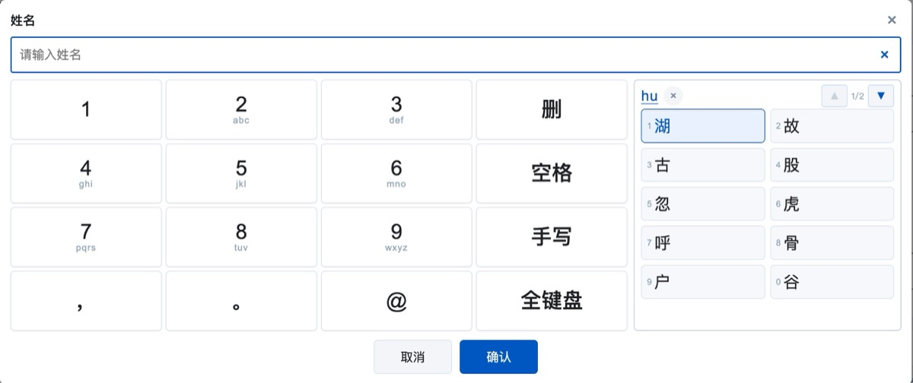
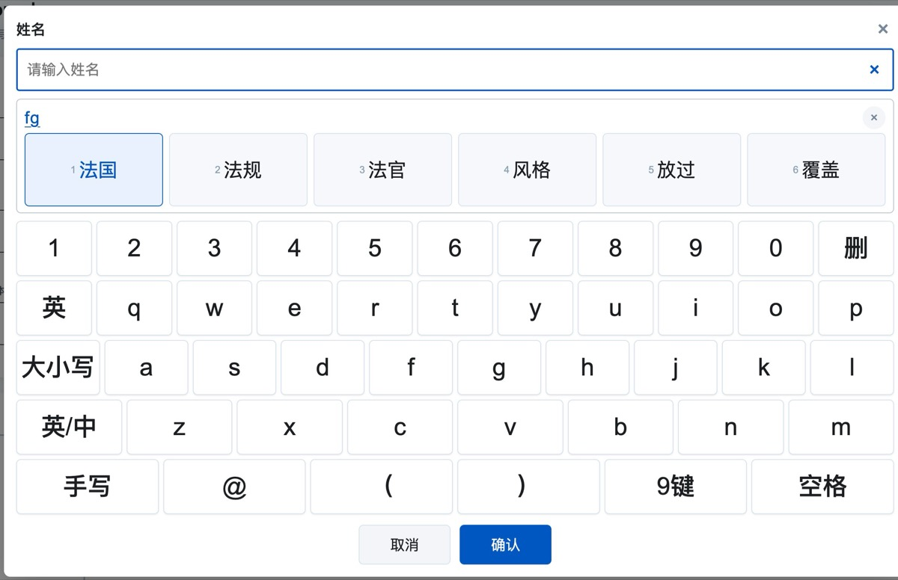
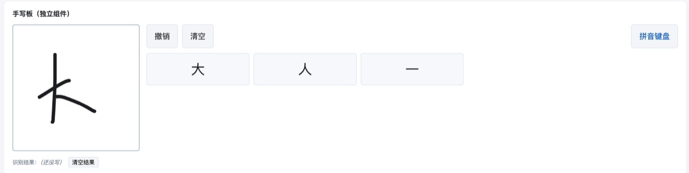

# pinyin-ime

中文拼音输入法组件包，从「出入境自助填表系统」里抽出来的。

## 效果

| 九宫格（默认，键大） | 全键盘 |
|---|---|
|  |  |

| 手写（神经网络，离线） |
|---|
|  |

| 包 | 说明 | 体积 |
|---|---|---|
| [`@startsi/pinyin-core`](packages/core) | 输入法内核：词图 DP、模糊音、简拼、姓名候选、bigram 语言模型。纯 TS，零框架依赖 | 2.5MB（gzip 1.4MB）<br>语言模型另 773KB |
| [`@startsi/vue-pinyin-ime`](packages/vue) | Vue3 输入控件：九宫格 / 全键盘 / 数字键盘、候选条、弹层。**不依赖任何 UI 框架** | 24KB + 6KB CSS |
| [`@startsi/vue-handwriting`](packages/handwriting) | Vue3 手写板：HanScribe 神经网络识别，离线 | 5.6KB + 1.5KB CSS |

## 为什么拆三个包

- **core 是纯函数**：`engine.press({t:'char', v:'z'})` → `engine.all()`，React / Vue2 / 原生 / Node 都能用
- **vue 包是薄壳**：只做渲染和事件，输入法逻辑一行都不重复
- **handwriting 独立**：大部分项目不需要手写，不需要就不用装

## 开发

```bash
npm install
npm run build     # 依次构建 core → handwriting → vue
npm test          # 跑 core 的 golden 用例
```

## 发布

```bash
# 三包版本号要一起改
npm version 0.1.1 --workspaces
npm publish --workspace packages/core --access public
npm publish --workspace packages/handwriting --access public
npm publish --workspace packages/vue --access public
```

## 词库与模型

- **拼音词库 / bigram 语言模型**打包在 `@startsi/pinyin-core` 里，由 jieba 词表 + 字幕词频派生
- **手写模型 7.5MB** 单独发在 `@startsi/handwriting-model`，不需要手写的项目不会下到它

数据来源与许可见 [THIRD_PARTY_NOTICES.md](THIRD_PARTY_NOTICES.md)。

## 目录

```
packages/
  core/         输入法内核（纯 TS）
  vue/          Vue3 输入控件
  handwriting/  Vue3 手写板
  model/        手写模型
playground/     本地演示（npm run dev）
scripts/        构建期辅助脚本
```

## 已知取舍

- **只提供 Vue3 绑定**。内核（core）本身零框架依赖，如果有 Vue2 / React 需求，
  可以基于 `createPinyinInput` 再包一层 DOM 版，目前没做——维护两份 UI 代码不值得。
- **不支持 SSR**：输入控件依赖 `window` / `ResizeObserver`，需要 `<ClientOnly>` 或动态导入。
